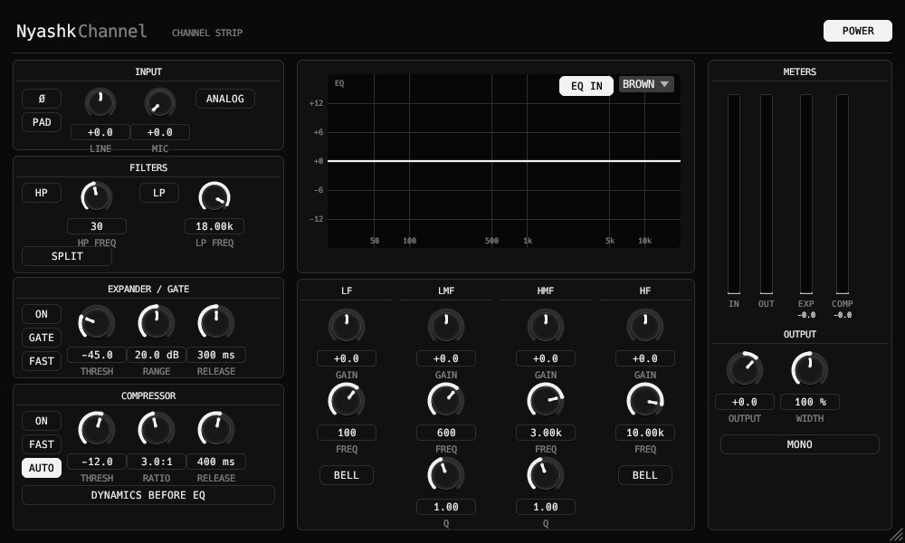

<div align="center">

# NyashkChannel

SSL-style channel strip VST3 plugin: input, filters, expander / gate, compressor, 4-band EQ and output.

[](https://github.com/xslimakx/NyashkChannel/actions/workflows/build.yml)
[](LICENSE)


[**Download**](https://github.com/xslimakx/NyashkChannel/releases/latest)

</div>

<p align="center"></p>

## Install
Use the Nyashk Launcher, or unzip the `.vst3` bundle from the latest release into your VST3 folder.

## Build
```
cargo xtask bundle -p nyashkchannel --release
```
The bundle appears in `target/bundled/`.

## License
MIT
